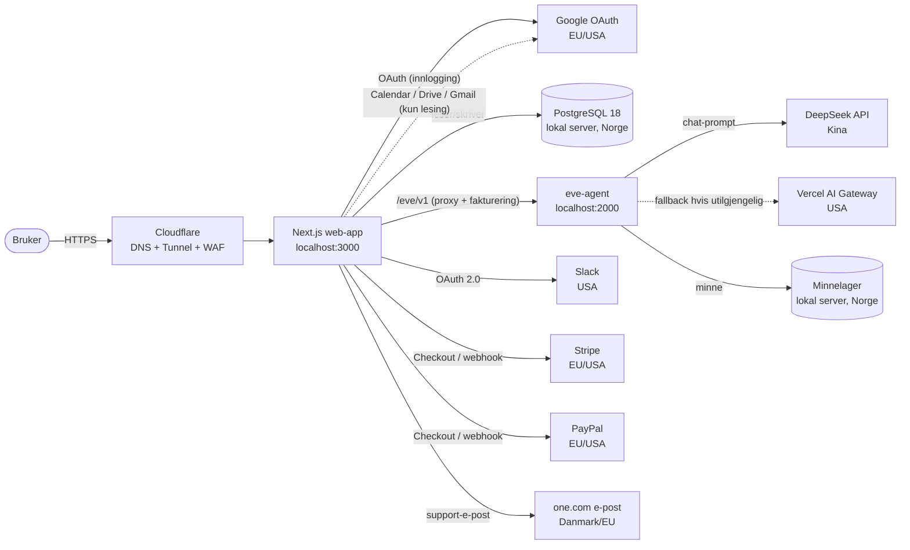

# Dataflyt-kart — Tech AI monkey

> **Formål:** vise hvilke personopplysninger som behandles, hvor de kommer fra, hvor de
> lagres, hvem de deles med og hvor lenge de beholdes. Dokumentet brukes som vedlegg i
> Googles **CASA**-vurdering (ASVS 8.1 «Data protection» og 1.1 «Secure software
> lifecycle») og som intern oversikt over behandlingsaktiviteter (GDPR art. 30).

Sist oppdatert: 2026-10-05 · Ansvarlig: Salazar Rivero Smart Things (org. 933 853 195)

---

## 1. Overordnet flyt

Hovedprinsipp: **all kundedata lagres lokalt** i vår egen PostgreSQL-database på serveren i
Norge. Databasen forlater aldri huset. Det som forlater EØS er bare (a) TLS-terminering hos
Cloudflare og (b) **teksten brukeren skriver i chatten**, som sendes til språkmodellen.

---

## 2. Datakategorier, formål og grunnlag

| # | Kategori | Eksempler | Formål | Rettslig grunnlag (GDPR) | Lagres hvor | Retensjon |
| --- | --- | --- | --- | --- | --- | --- |
| 1 | Konto | navn, e-post, passord-hash (Argon2id) | opprette og sikre konto | art. 6(1)(b) avtale | `user`, `account`, `session` i Postgres | til konto slettes (+30 d) |
| 2 | Kontakt | telefon, land, adresse, postnr. | fakturering, support | art. 6(1)(b) | Postgres | til konto slettes |
| 3 | Samtaler/artefakter | chat-meldinger, notatbøker, innhold | levere tjenesten | art. 6(1)(b) | Postgres (`artifact`, `notebook`) + agentens minnelager | til bruker sletter / konto slettes |
| 4 | Integrasjonstokens | OAuth-tokens for Google/Slack | utføre koblingen bruker ba om | art. 6(1)(b) | `integration` i Postgres, **AES-256-GCM** | til frakobling / konto slettes |
| 5 | Betaling | navn, e-post, beløp, transaksjons-id | abonnement og fakturering | art. 6(1)(b) + bokføringsloven | Stripe/PayPal + `subscription` | 5 år (bokføring) |
| 6 | Bruk/forbruk | tokens brukt, plan | fakturering, misbruksvern | art. 6(1)(b) | `tokenBalance`, `tokenTransaction` | til konto slettes |
| 7 | Revisjonsspor | hvem gjorde hva, når | sikkerhet, sporbarhet | art. 6(1)(f) berettiget interesse | `auditLog` | 12 mnd |
| 8 | Driftslogger | IP, tidspunkt, HTTP-status | feilsøking, angrepsvern | art. 6(1)(f) | journald/Cloudflare | 30 d |
| 9 | Backup | kryptert dump av hele databasen | gjenoppretting etter feil | art. 6(1)(c)/(f) | `~/backups/tech-ai-monkey` (lokal disk) | 30 d daglig + 12 mnd månedlig |

---

## 3. Flyt per funksjon

### 3.1 Registrering og pålogging
1. Bruker velger **Google** eller **e-post + passord**.
2. Google-flyt: nettleseren sendes til Google, som returnerer et id-token til
   `https://tech-ai.tech/api/auth/callback/google`. Vi lagrer **e-post, navn og
   Google-konto-id** — aldri passordet.
3. E-post-flyt: passordet hashes med **Argon2id** og lagres som hash.
4. Sesjonen er et **JWT**-kaksekort (`HttpOnly`, `Secure`, `SameSite`), signert med `AUTH_SECRET`.

### 3.2 Chat med agenten
1. Nettleseren kaller `/eve/v1/*` på `tech-ai.tech` med brukerens sesjon.
2. Web-appen verifiserer sesjonen og **fakturerer tokens**, og videresender til agenten på
   `127.0.0.1:2000`.
3. Agenten sender **prompt-teksten** til språkmodellen:
   - primært **DeepSeek** (`api.deepseek.com`, Kina),
   - fallback **Vercel AI Gateway** (USA) hvis primærleverandøren svikter.
4. Svaret strømmes tilbake. Samtalen lagres lokalt.

> **Viktig for personvern:** bare teksten brukeren selv skriver, forlater EØS. Vi ber
> brukeren la være å lime inn sensitive opplysninger i chatten (se `/privacy` § 6).

### 3.3 Integrasjoner («Apps to connect»)
1. `GET /api/integrations/<provider>/connect` → leverandørens samtykkeside.
2. `GET /api/integrations/<provider>/callback` bytter kode mot tokens.
3. Tokens **krypteres (AES-256-GCM envelope, KEK = `SSN_KEK`)** før de lagres.
4. Google-integrasjonene ber kun om **lesetilgang**: `calendar.readonly`, `drive.readonly`,
   `gmail.readonly`. Vi kan ikke endre eller sende på vegne av brukeren via disse.
5. Frakobling sletter token-raden umiddelbart.

### 3.4 Betaling
- Kort: **Stripe Checkout** — kortdata går direkte til Stripe, vi ser dem aldri.
- PayPal: **PayPal Orders API**, capture på `POST /api/billing/paypal/capture-order`.
- Krypto: egen kvote/verifiseringsflyt (`web/lib/billing/crypto.ts`).
- Webhooks signaturverifiseres før de påvirker abonnementet.
- Vi lagrer bare **abonnementstilstand og transaksjons-id**.

### 3.5 Drift, logging og backup
- Alle tre tjenestene kjører som systemd-enheter: `myai-web`, `myai-agent`, `myai-backup`.
- **Backup** tar en `pg_dump` hver natt kl. 03:30, komprimerer den og lagrer den lokalt med
  filrettighet `600`. Se [`backup-og-gjenoppretting.md`](backup-og-gjenoppretting.md).
- Inngående trafikk går via **Cloudflare Tunnel** — ingen porter er åpne mot internett.

---

## 4. Overføringer utenfor EØS

| Mottaker | Land | Hva overføres | Grunnlag / tiltak |
| --- | --- | --- | --- |
| Cloudflare | USA (EU-knutepunkter brukes) | IP, HTTP-metadata | SCC + DPA, TLS-terminering |
| Google | USA/EU | konto-id, e-post, tilkoblet innhold | SCC + Google DPAS |
| Slack | USA | tokens, meldinger brukeren kobler | SCC + DPA |
| Stripe / PayPal | USA/EU | betalings- og fakturadata | SCC + DPA |
| Vercel | USA | prompt (kun fallback) | SCC + DPA |
| DeepSeek | **Kina** | **prompt-teksten i chat** | SCC; overføringen er begrenset til det brukeren skriver. Vi jobber med et EØS-alternativ for å fjerne den helt. |

Ingen passord eller integrasjons-tokens forlater EØS i klartekst.

---

## 5. Underleverandører

Den oppdaterte listen med formål og datatyper finnes i personvernerklæringen:
<https://tech-ai.tech/privacy> (§5). Endres listen, skal både `/privacy` og dette dokumentet
oppdateres, og kunder varsles i tråd med avtalevilkårene.

---

## 6. Sletterutiner

| Handling | Hva skjer | Hvor i koden |
| --- | --- | --- |
| «Download my data» | JSON-eksport av alt vi har (uten passordhash/tokens) | `web/app/api/account/export/route.ts`, `web/lib/account.ts` |
| «Delete my account» | sletter bruker + alle tilknyttede rader, logger ut | `web/lib/account.ts` → `deleteUserData()`, `web/app/dashboard/actions.ts` |
| «Clear chat» | sletter samtalehistorikk | `POST /eve/v1/session/:id/clear` |
| Utløpt backup | rulles ut automatisk (30 d / 12 mnd) | `deploy/backup-db.sh` |

Sletting er **kaskaderende** (fremmednøkler med `ON DELETE CASCADE`), så ingen foreldreløse
rader blir liggende.

---

## 7. Sikkerhetstiltak knyttet til hver flyt

| Flyt | Tiltak |
| --- | --- |
| Nettleser → Cloudflare → server | TLS 1.2+, HSTS, ingen åpne innkommende porter |
| Nettleser → web-app | CSP, `X-Frame-Options: DENY`, `X-Content-Type-Options`, `Referrer-Policy` |
| Web-app → database | lokal socket/TCP på `127.0.0.1`, egen DB-rolle med minste privilegium |
| Integrasjons-tokens i DB | AES-256-GCM envelope, KEK i miljøvariabel utenfor DB |
| Passord | Argon2id med salt |
| Web-app → agent | delt hemmelighet `AGENT_API_KEY_SECRET`, feiler lukket |
| Agent → språkmodell | HTTPS til leverandøren, kun prompt-tekst |
| Backup | `pg_dump | gzip`, filrettighet `600`, egen mappe `700`, aldri i git |
| Revisjon | `audit_log`-tabell + journald |

---

## 8. Vedlikehold av dette dokumentet

Oppdater dokumentet når:

- en **ny underleverandør** tas i bruk eller en fjernes,
- en **ny scope** eller et nytt datafelt innføres,
- **retensjon** endres,
- **backup**-oppsettet endres (lagringssted, frekvens, oppbevaringstid).

Sist verifisert mot kode: 2026-10-05.
